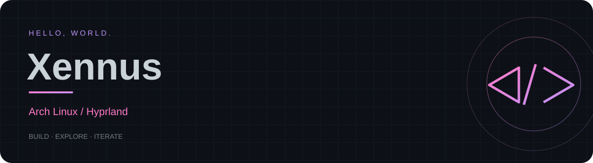
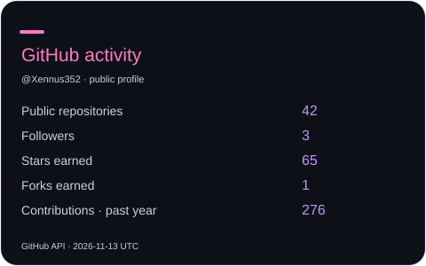
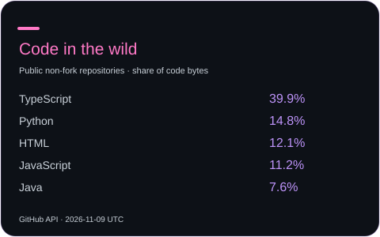

<!-- Generated from profile.json. See SETUP.md for customization. -->

Asia/Yangon

 ·  · 

---

### ⌘ My workspace

<table>
<tr><th>Environment</th><th>Daily driver</th></tr>
<tr><td>Operating system</td><td><strong>Arch Linux</strong></td></tr>
<tr><td>Window manager</td><td><strong>Hyprland</strong></td></tr>
</table>

### ◇ Tools & technologies

<strong>Systems</strong>

---

### ↗ GitHub activity

From GitHub’s API · refreshed daily · <a href="https://github.com/Xennus352?tab=repositories">Explore my repositories ↗</a>

### ∿ A year in contributions

<picture>
<source media="(prefers-color-scheme: dark)" srcset="./assets/github-contribution-grid-snake-dark.svg">

</picture>

One square, one day. Always building.

